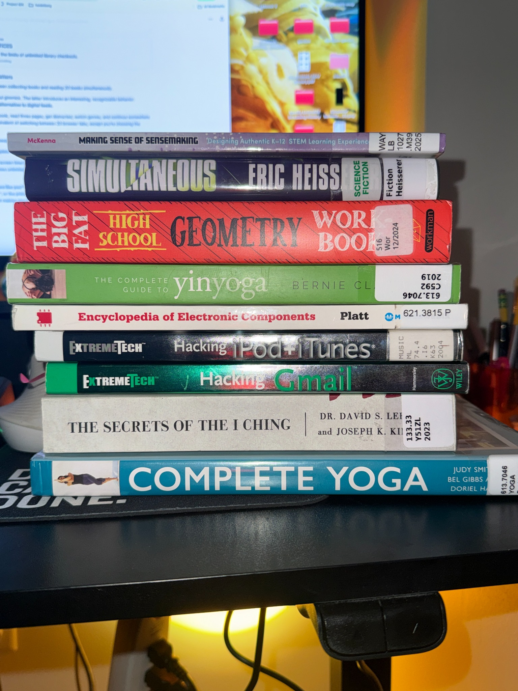

# Haul 001

```text
9 books this haul | 9 total checkouts

Making Sense of Sensemaking — TJ McKenna
Simultaneous — Eric Heisserer
The Big Fat High School Geometry Workbook — Workman Publishing
The Complete Guide to Yin Yoga — Bernie Clark
Encyclopedia of Electronic Components — Charles Platt
Hacking iPod + iTunes — Scott Knaster
Hacking Gmail — Ben Hammersley
The Secrets of the I Ching — David S. Lee and Joseph K. Kim
Complete Yoga — Judy Smith, Bel Gibbs, and Doriel Hall
```

## Books

| title | author | page_photo |
| --- | --- | --- |
| Making Sense of Sensemaking | TJ McKenna | |
| Simultaneous | Eric Heisserer | |
| The Big Fat High School Geometry Workbook | Workman Publishing | |
| The Complete Guide to Yin Yoga | Bernie Clark | |
| Encyclopedia of Electronic Components | Charles Platt | |
| Hacking iPod + iTunes | Scott Knaster | |
| Hacking Gmail | Ben Hammersley | |
| The Secrets of the I Ching | David S. Lee and Joseph K. Kim | |
| Complete Yoga | Judy Smith, Bel Gibbs, and Doriel Hall | |

<details>
<summary>Photos</summary>

<a href="photos/stack.jpg"></a>

</details>

<details>
<summary>Production notes</summary>

- Recovered source photos are available below for carousel selection. Interior page photos are still pending.
- [ ] Capture one interior page per book and link it in the matching Books row under `page_photo`.
- [ ] Record the actual TikTok post date and URL once confirmed.

</details>
