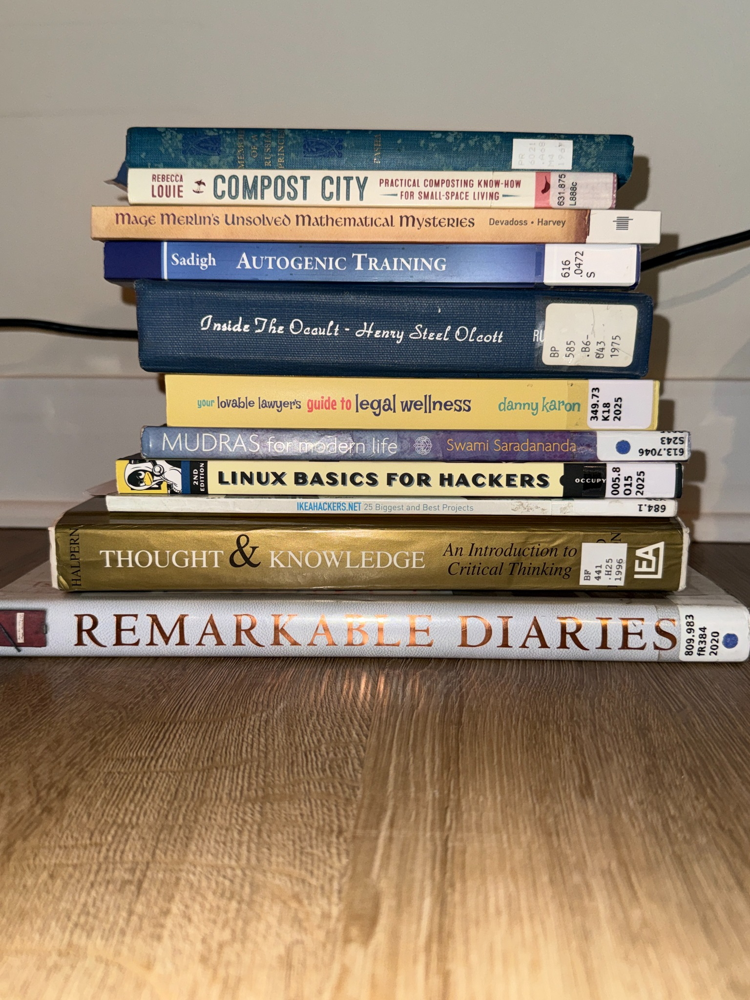
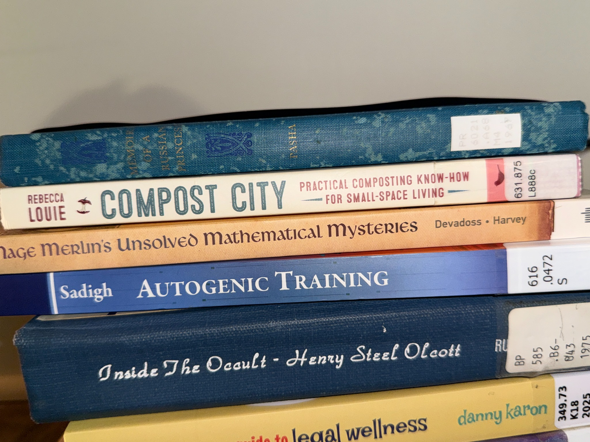

# Haul 002

```text
11 books this haul | 20 total checkouts

Memoirs of a Russian Princess — Katoumba Pasha
Compost City — Rebecca Louie
Mage Merlin’s Unsolved Mathematical Mysteries — Satyan Linus Devadoss and Matthew Harvey
Autogenic Training — Micah R. Sadigh
Inside the Occult — Henry Steel Olcott
Your Lovable Lawyer’s Guide to Legal Wellness — Danny Karon
Mudras for Modern Life — Swami Saradananda
Linux Basics for Hackers — OccupyTheWeb
IKEA Hackers: 25 Biggest and Best Projects — Jules Yap
Thought & Knowledge — Diane F. Halpern
Remarkable Diaries — DK
```

## Books

| title | author | page_photo |
| --- | --- | --- |
| Memoirs of a Russian Princess | Katoumba Pasha | |
| Compost City | Rebecca Louie | |
| Mage Merlin’s Unsolved Mathematical Mysteries | Satyan Linus Devadoss and Matthew Harvey | |
| Autogenic Training | Micah R. Sadigh | |
| Inside the Occult | Henry Steel Olcott | |
| Your Lovable Lawyer’s Guide to Legal Wellness | Danny Karon | |
| Mudras for Modern Life | Swami Saradananda | |
| Linux Basics for Hackers | OccupyTheWeb | |
| IKEA Hackers: 25 Biggest and Best Projects | Jules Yap | |
| Thought & Knowledge | Diane F. Halpern | |
| Remarkable Diaries | DK | |

<details>
<summary>Photos</summary>

<a href="photos/stack.jpg"></a>
<a href="photos/stack-detail.jpg"></a>

</details>

<details>
<summary>Production notes</summary>

- Recovered source photos are available below for carousel selection. Interior page photos are still pending.
- [ ] Capture one interior page per book and link it in the matching Books row under `page_photo`.
- [ ] Record the actual TikTok post date and URL once confirmed.
- [Memoirs of a Russian Princess](https://frostrarebooks.com/wp-content/uploads/2024/10/October-2024-Catalogue.pdf)

</details>
