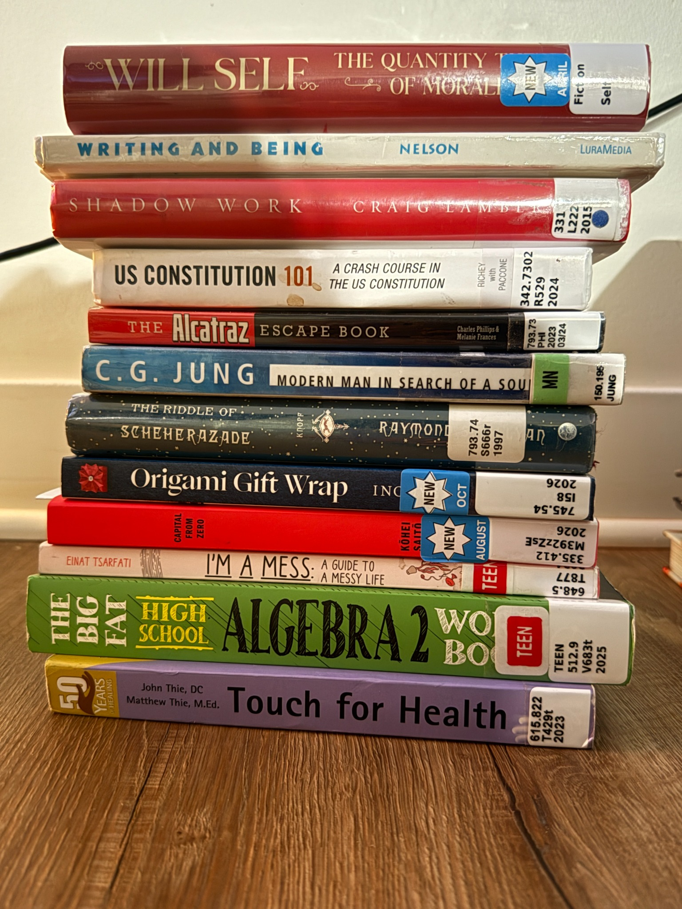

# Haul 003

```text
12 books this haul | 32 total checkouts

The Quantity Theory of Morality — Will Self
Writing and Being — G. Lynn Nelson
Shadow Work — Craig Lambert
US Constitution 101 — Tom Richey with Peter Paccone
The Alcatraz Escape Book — Charles Phillips and Melanie Frances
Modern Man in Search of a Soul — C. G. Jung
The Riddle of Scheherazade — Raymond Smullyan
Origami Gift Wrap — Megumi Lorna Inouye
Capital from Zero — Kōhei Saitō
I’m a Mess: A Guide to a Messy Life — Einat Tsarfati
The Big Fat High School Algebra 2 Workbook — Workman Publishing
Touch for Health — John Thie and Matthew Thie
```

## Books

| title | author | page_photo |
| --- | --- | --- |
| The Quantity Theory of Morality | Will Self | |
| Writing and Being | G. Lynn Nelson | |
| Shadow Work | Craig Lambert | |
| US Constitution 101 | Tom Richey with Peter Paccone | |
| The Alcatraz Escape Book | Charles Phillips and Melanie Frances | |
| Modern Man in Search of a Soul | C. G. Jung | |
| The Riddle of Scheherazade | Raymond Smullyan | |
| Origami Gift Wrap | Megumi Lorna Inouye | |
| Capital from Zero | Kōhei Saitō | |
| I’m a Mess: A Guide to a Messy Life | Einat Tsarfati | |
| The Big Fat High School Algebra 2 Workbook | Workman Publishing | |
| Touch for Health | John Thie and Matthew Thie | |

<details>
<summary>Photos</summary>

<a href="photos/stack.jpg"></a>

</details>

<details>
<summary>Production notes</summary>

- Recovered source photos are available below for carousel selection. Interior page photos are still pending.
- [ ] Capture one interior page per book and link it in the matching Books row under `page_photo`.
- [ ] Record the actual TikTok post date and URL once confirmed.
- The Algebra 2 workbook is a different title from the Algebra 2 notebook in haul 007.

</details>
