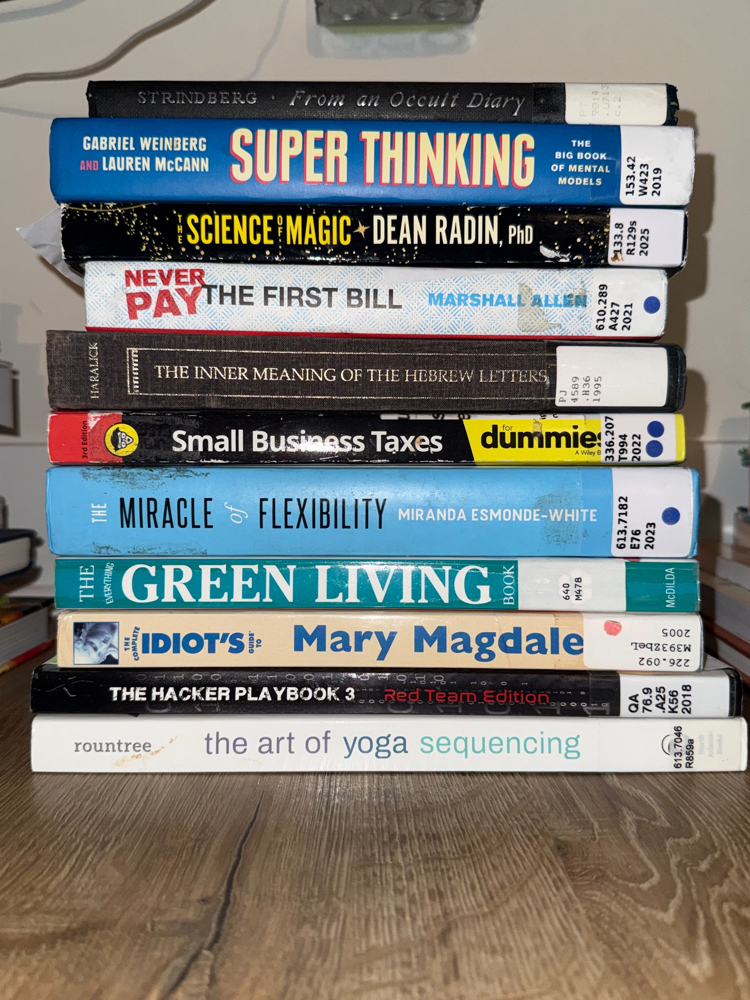

# Haul 005

```text
11 books this haul | 55 total checkouts

From an Occult Diary — August Strindberg
Super Thinking — Gabriel Weinberg and Lauren McCann
The Science of Magic — Dean Radin
Never Pay the First Bill — Marshall Allen
The Inner Meaning of the Hebrew Letters — Robert M. Haralick
Small Business Taxes for Dummies — Eric Tyson
The Miracle of Flexibility — Miranda Esmonde-White
The Everything Green Living Book — Diane Gow McDilda
The Complete Idiot’s Guide to Mary Magdalene — Lesa Bellevie
The Hacker Playbook 3: Red Team Edition — Peter Kim
The Art of Yoga Sequencing — Sage Rountree
```

## Books

| title | author | page_photo |
| --- | --- | --- |
| From an Occult Diary | August Strindberg | |
| Super Thinking | Gabriel Weinberg and Lauren McCann | |
| The Science of Magic | Dean Radin | |
| Never Pay the First Bill | Marshall Allen | |
| The Inner Meaning of the Hebrew Letters | Robert M. Haralick | |
| Small Business Taxes for Dummies | Eric Tyson | |
| The Miracle of Flexibility | Miranda Esmonde-White | |
| The Everything Green Living Book | Diane Gow McDilda | |
| The Complete Idiot’s Guide to Mary Magdalene | Lesa Bellevie | |
| The Hacker Playbook 3: Red Team Edition | Peter Kim | |
| The Art of Yoga Sequencing | Sage Rountree | |

<details>
<summary>Photos</summary>

<a href="photos/stack.jpg"></a>

</details>

<details>
<summary>Production notes</summary>

- Recovered source photos are available below for carousel selection. Interior page photos are still pending.
- [ ] Capture one interior page per book and link it in the matching Books row under `page_photo`.
- [ ] Record the actual TikTok post date and URL once confirmed.

</details>
