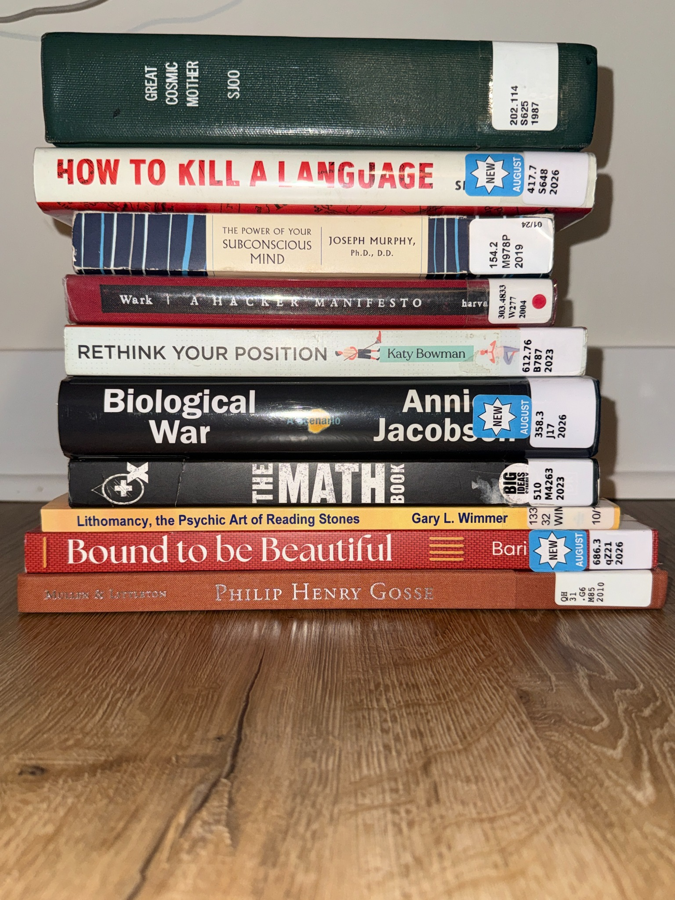

# Haul 006

```text
10 books this haul | 65 total checkouts

The Great Cosmic Mother — Monica Sjöö and Barbara Mor
How to Kill a Language — Sophia Smith Galer
The Power of Your Subconscious Mind — Joseph Murphy
A Hacker Manifesto — McKenzie Wark
Rethink Your Position — Katy Bowman
Biological War — Annie Jacobsen
The Math Book — DK
Lithomancy, the Psychic Art of Reading Stones — Gary L. Wimmer
Bound to Be Beautiful — Bari Zaki
Philip Henry Gosse — Gary R. Mullen and Taylor D. Littleton
```

## Books

| title | author | page_photo |
| --- | --- | --- |
| The Great Cosmic Mother | Monica Sjöö and Barbara Mor | |
| How to Kill a Language | Sophia Smith Galer | |
| The Power of Your Subconscious Mind | Joseph Murphy | |
| A Hacker Manifesto | McKenzie Wark | |
| Rethink Your Position | Katy Bowman | |
| Biological War | Annie Jacobsen | |
| The Math Book | DK | |
| Lithomancy, the Psychic Art of Reading Stones | Gary L. Wimmer | |
| Bound to Be Beautiful | Bari Zaki | |
| Philip Henry Gosse | Gary R. Mullen and Taylor D. Littleton | |

<details>
<summary>Photos</summary>

<a href="photos/stack.jpg"></a>

</details>

<details>
<summary>Production notes</summary>

- Recovered source photos are available below for carousel selection. Interior page photos are still pending.
- [ ] Capture one interior page per book and link it in the matching Books row under `page_photo`.
- [ ] Record the actual TikTok post date and URL once confirmed.
- [Philip Henry Gosse](https://www.uapress.ua.edu/9780817317089/philip-henry-gosse/)

</details>
