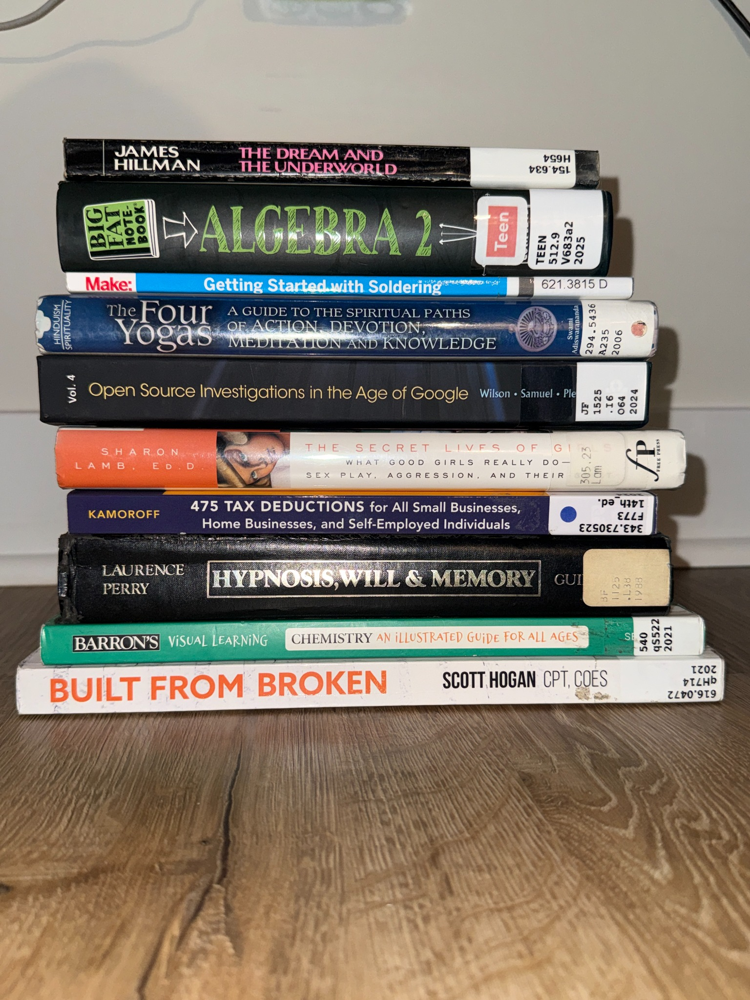

# Haul 007

```text
10 books this haul | 75 total checkouts

The Dream and the Underworld — James Hillman
Big Fat Notebook: Algebra 2 — Workman Publishing
Make: Getting Started with Soldering — Marc de Vinck
The Four Yogas — Swami Adiswarananda
Open Source Investigations in the Age of Google, Vol. 4 — Henrietta Wilson, Olamide Samuel, and Dan Plesch (eds.)
The Secret Lives of Girls — Sharon Lamb
475 Tax Deductions for All Small Businesses, Home Businesses, and Self-Employed Individuals — Bernard B. Kamoroff
Hypnosis, Will & Memory — Jean-Roch Laurence and Campbell Perry
Chemistry: An Illustrated Guide for All Ages — Ali O. Sezer
Built from Broken — Scott Hogan
```

## Books

| title | author | page_photo |
| --- | --- | --- |
| The Dream and the Underworld | James Hillman | |
| Big Fat Notebook: Algebra 2 | Workman Publishing | |
| Make: Getting Started with Soldering | Marc de Vinck | |
| The Four Yogas | Swami Adiswarananda | |
| Open Source Investigations in the Age of Google, Vol. 4 | Henrietta Wilson, Olamide Samuel, and Dan Plesch (eds.) | |
| The Secret Lives of Girls | Sharon Lamb | |
| 475 Tax Deductions for All Small Businesses, Home Businesses, and Self-Employed Individuals | Bernard B. Kamoroff | |
| Hypnosis, Will & Memory | Jean-Roch Laurence and Campbell Perry | |
| Chemistry: An Illustrated Guide for All Ages | Ali O. Sezer | |
| Built from Broken | Scott Hogan | |

<details>
<summary>Photos</summary>

<a href="photos/stack.jpg"></a>

</details>

<details>
<summary>Production notes</summary>

- Recovered source photos are available below for carousel selection. Interior page photos are still pending.
- [ ] Capture one interior page per book and link it in the matching Books row under `page_photo`.
- [ ] Record the actual TikTok post date and URL once confirmed.
- The Algebra 2 notebook is a different title from the Algebra 2 workbook in haul 003.

</details>
