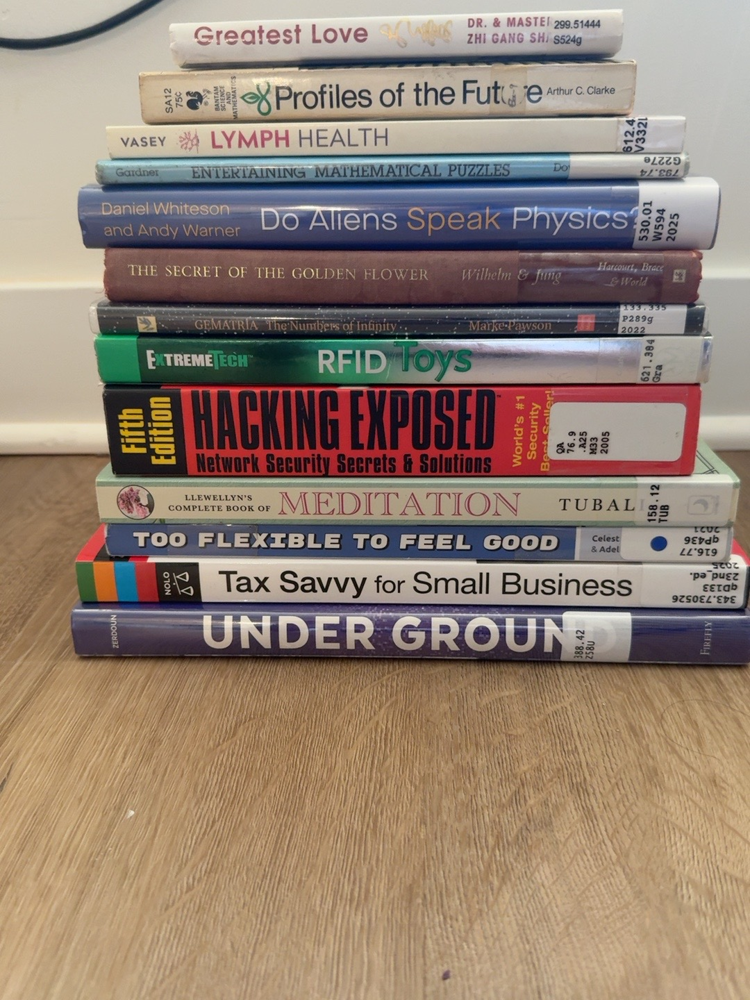

# Haul 008

```text
13 books this haul | 88 total checkouts

Greatest Love — Zhi Gang Sha
Profiles of the Future — Arthur C. Clarke
Lymph Health — Christopher Vasey
Entertaining Mathematical Puzzles — Martin Gardner
Do Aliens Speak Physics? — Daniel Whiteson and Andy Warner
The Secret of the Golden Flower — Richard Wilhelm (trans.) and C. G. Jung (commentary)
Gematria: The Numbers of Infinity — Marke Pawson
RFID Toys — Amal Graafstra
Hacking Exposed: Network Security Secrets & Solutions (5th ed.) — Stuart McClure, Joel Scambray, and George Kurtz
Llewellyn’s Complete Book of Meditation — Shai Tubali
Too Flexible to Feel Good — Celest Pereira and Adell Bridges
Tax Savvy for Small Business — Stephen Fishman
Under Ground: Subways and Metros of the World — Catherine Zerdoun
```

## Books

| title | author | page_photo |
| --- | --- | --- |
| Greatest Love | Zhi Gang Sha | |
| Profiles of the Future | Arthur C. Clarke | |
| Lymph Health | Christopher Vasey | |
| Entertaining Mathematical Puzzles | Martin Gardner | |
| Do Aliens Speak Physics? | Daniel Whiteson and Andy Warner | |
| The Secret of the Golden Flower | Richard Wilhelm (trans.) and C. G. Jung (commentary) | |
| Gematria: The Numbers of Infinity | Marke Pawson | |
| RFID Toys | Amal Graafstra | |
| Hacking Exposed: Network Security Secrets & Solutions (5th ed.) | Stuart McClure, Joel Scambray, and George Kurtz | |
| Llewellyn’s Complete Book of Meditation | Shai Tubali | |
| Too Flexible to Feel Good | Celest Pereira and Adell Bridges | |
| Tax Savvy for Small Business | Stephen Fishman | |
| Under Ground: Subways and Metros of the World | Catherine Zerdoun | |

<details>
<summary>Photos</summary>

<a href="photos/stack.jpg"></a>

</details>

<details>
<summary>Production notes</summary>

- Recovered source photos are available below for carousel selection. Interior page photos are still pending.
- [ ] Capture one interior page per book and link it in the matching Books row under `page_photo`.
- [ ] Record the actual TikTok post date and URL once confirmed.
- The Gematria book in this stack is by Marke Pawson. Haul 011 has a different book with the same main title.
- [Gematria: The Numbers of Infinity](https://www.biggerbooks.com/gematria-numbers-infinity-pawson-marke/bk/9780954723002)

</details>
