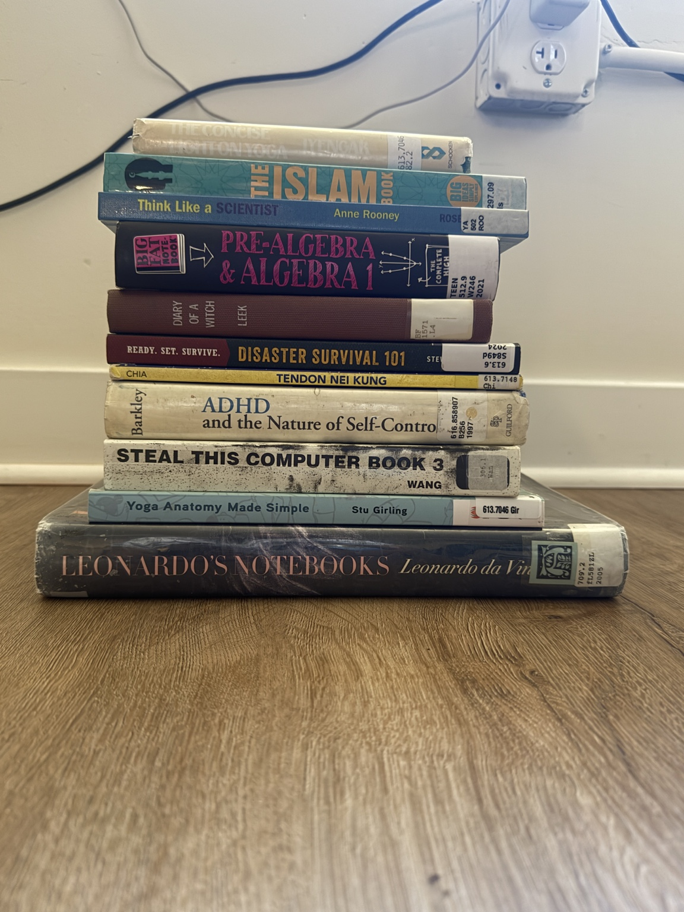

# Haul 009

```text
11 books this haul | 99 total checkouts

The Concise Light on Yoga — B. K. S. Iyengar
The Islam Book — DK
Think Like a Scientist — Anne Rooney
Big Fat Notebook: Pre-Algebra & Algebra 1 — Workman Publishing and Jason Wang
Diary of a Witch — Sybil Leek
Disaster Survival 101 — Creek Stewart
Tendon Nei Kung — Mantak Chia
ADHD and the Nature of Self-Control — Russell A. Barkley
Steal This Computer Book 3 — Wallace Wang
Yoga Anatomy Made Simple — Stu Girling
Leonardo’s Notebooks — Leonardo da Vinci
```

## Books

| title | author | page_photo |
| --- | --- | --- |
| The Concise Light on Yoga | B. K. S. Iyengar | |
| The Islam Book | DK | |
| Think Like a Scientist | Anne Rooney | |
| Big Fat Notebook: Pre-Algebra & Algebra 1 | Workman Publishing and Jason Wang | |
| Diary of a Witch | Sybil Leek | |
| Disaster Survival 101 | Creek Stewart | |
| Tendon Nei Kung | Mantak Chia | |
| ADHD and the Nature of Self-Control | Russell A. Barkley | |
| Steal This Computer Book 3 | Wallace Wang | |
| Yoga Anatomy Made Simple | Stu Girling | |
| Leonardo’s Notebooks | Leonardo da Vinci | |

<details>
<summary>Photos</summary>

<a href="photos/stack.jpg"></a>

</details>

<details>
<summary>Production notes</summary>

- Recovered source photos are available below for carousel selection. Interior page photos are still pending.
- [ ] Capture one interior page per book and link it in the matching Books row under `page_photo`.
- [ ] Record the actual TikTok post date and URL once confirmed.
- [The Concise Light on Yoga](https://openlibrary.org/books/OL5982246M/Light_on_yoga)

</details>
