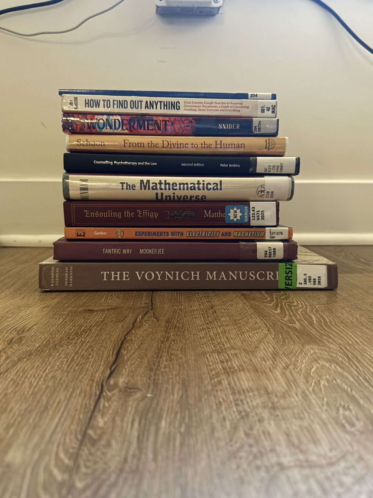
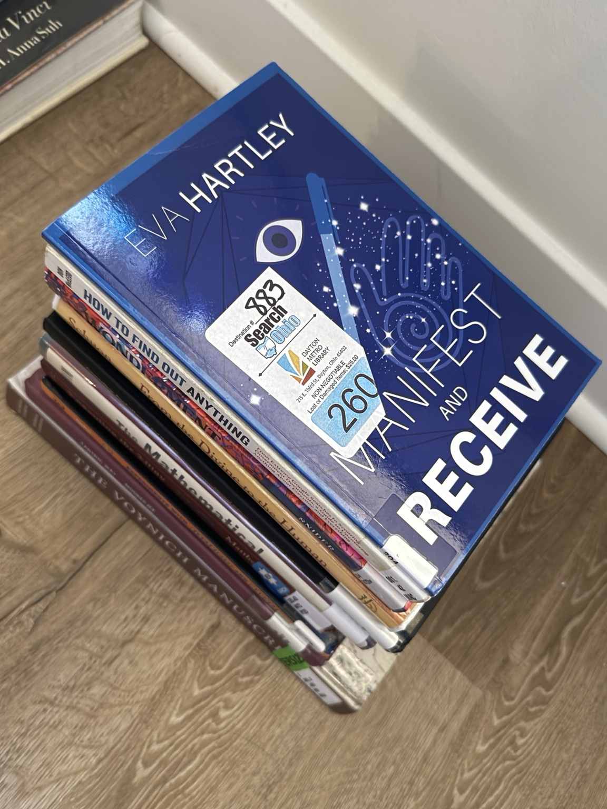

# Haul 010

```text
10 books this haul | 109 total checkouts

Manifest and Receive — Eva Hartley
How to Find Out Anything — Don MacLeod
Wonderment — Grant Snider
From the Divine to the Human — Frithjof Schuon
Counselling, Psychotherapy and the Law — Peter Jenkins
The Mathematical Universe — William Dunham
Ensouling the Effigy — Matthew Venus
Experiments with Electricity and Magnetism — Robert Gardner
Tantric Way — Ajit Mookerjee
The Voynich Manuscript — Raymond Clemens (ed.)
```

## Books

| title | author | page_photo |
| --- | --- | --- |
| Manifest and Receive | Eva Hartley | |
| How to Find Out Anything | Don MacLeod | |
| Wonderment | Grant Snider | |
| From the Divine to the Human | Frithjof Schuon | |
| Counselling, Psychotherapy and the Law | Peter Jenkins | |
| The Mathematical Universe | William Dunham | |
| Ensouling the Effigy | Matthew Venus | |
| Experiments with Electricity and Magnetism | Robert Gardner | |
| Tantric Way | Ajit Mookerjee | |
| The Voynich Manuscript | Raymond Clemens (ed.) | |

<details>
<summary>Photos</summary>

<a href="photos/stack.jpg"></a>
<a href="photos/cover-and-stack.jpg"></a>

</details>

<details>
<summary>Production notes</summary>

- Recovered source photos are available below for carousel selection. Interior page photos are still pending.
- [ ] Capture one interior page per book and link it in the matching Books row under `page_photo`.
- [ ] Record the actual TikTok post date and URL once confirmed.
- The cover photo supplies the title and author on the reconstructed blue spine, Manifest and Receive by Eva Hartley.
- [Ensouling the Effigy](https://redwheelweiser.com/book/ensouling-the-effigy-9781964537030/)

</details>
