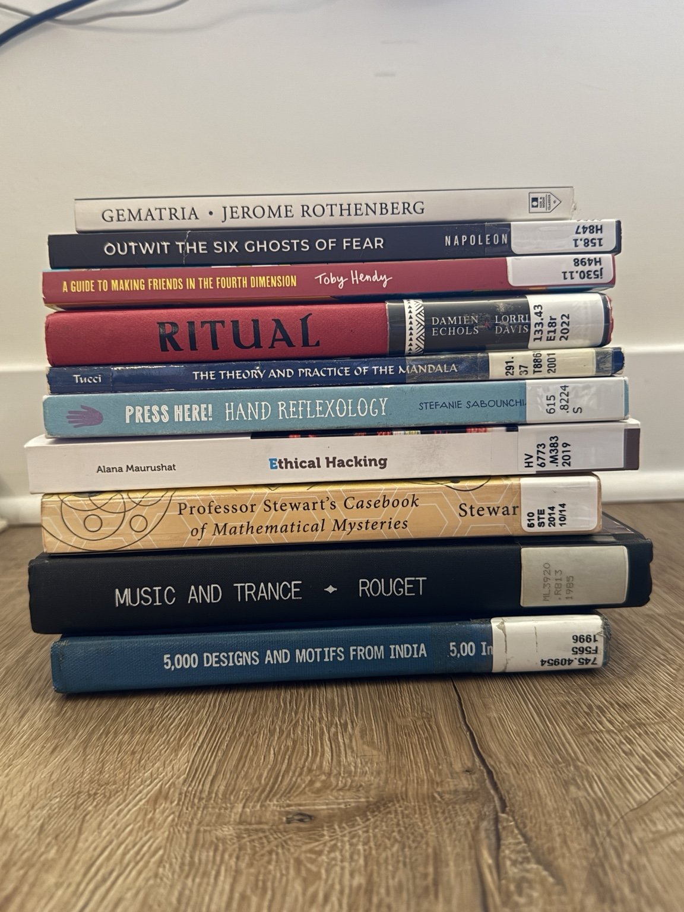

# Haul 011

```text
10 books this haul | 119 total checkouts

Gematria — Jerome Rothenberg
Outwit the Six Ghosts of Fear — Napoleon Hill
A Guide to Making Friends in the Fourth Dimension — Toby Hendy
Ritual — Damien Echols and Lorri Davis
The Theory and Practice of the Mandala — Giuseppe Tucci
Press Here! Hand Reflexology — Stefanie Sabounchian
Ethical Hacking — Alana Maurushat
Professor Stewart’s Casebook of Mathematical Mysteries — Ian Stewart
Music and Trance — Gilbert Rouget
5,000 Designs and Motifs from India — Ajit Mookerjee (ed.)
```

## Books

| title | author | page_photo |
| --- | --- | --- |
| Gematria | Jerome Rothenberg | |
| Outwit the Six Ghosts of Fear | Napoleon Hill | |
| A Guide to Making Friends in the Fourth Dimension | Toby Hendy | |
| Ritual | Damien Echols and Lorri Davis | |
| The Theory and Practice of the Mandala | Giuseppe Tucci | |
| Press Here! Hand Reflexology | Stefanie Sabounchian | |
| Ethical Hacking | Alana Maurushat | |
| Professor Stewart’s Casebook of Mathematical Mysteries | Ian Stewart | |
| Music and Trance | Gilbert Rouget | |
| 5,000 Designs and Motifs from India | Ajit Mookerjee (ed.) | |

<details>
<summary>Photos</summary>

<a href="photos/stack.jpg"></a>

</details>

<details>
<summary>Production notes</summary>

- Recovered source photos are available below for carousel selection. Interior page photos are still pending.
- [ ] Capture one interior page per book and link it in the matching Books row under `page_photo`.
- [ ] Record the actual TikTok post date and URL once confirmed.
- The Gematria book in this stack is by Jerome Rothenberg. Haul 008 has a different book with the same main title.

</details>
